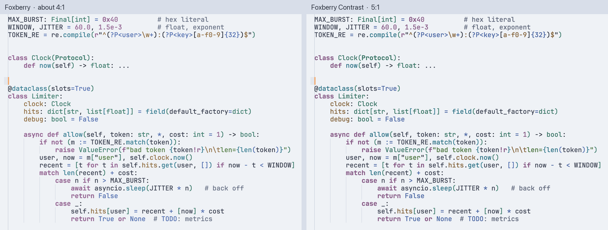

# Foxberry: palette specification

Foxberry is a light variant of the Nord palette. This document explains how each
color was derived. It is also meant for people and agents adding the theme to
another program. In the tables, the "Nord" column is the original (dark) Nord
color that the Foxberry color comes from.

Status: palette version 2.4 (2026-11-13). All values are in the tables below.

## Core principles

1. **The role decides the color.** The same Nord color has different Foxberry
   counterparts depending on whether it is text, a background or a badge (see
   "Mapping Nord → Foxberry").
2. **Contrast is measured on the terminal background `#E5E9F0`.** Base text is at
   least 7:1. Text accents are about 3.8:1 (4.0:1 on `#ECEFF4`, the background
   they were tuned on); at a terminal font size of about 18 pt, the WCAG AA
   threshold for large text is 3:1. "Bright" colors (charts, markers, bars) are
   about 2.8:1, above their 2.5:1 target.
3. **Yellow becomes bronze.** A dark, readable yellow on a light background
   always turns brown, so since 2.3 Foxberry's nord13 is a muted "Bronze"
   `#967044` (3.7:1 on `#E5E9F0`), with the same lightness and chroma as the other
   accents (OKLCH L 0.57, C 0.077, like the original nord13). The earlier gold
   `#AE7500` (2.1–2.2) was the lightest and most saturated accent and stood out
   from the palette. Dark text on bronze reaches only 2.3:1, so for highlight
   backgrounds use the nord13 badge, or light text on bronze.

## Surfaces and text

  | Role                                                                           | Nord                                                         | Foxberry                          |
  | ------------------------------------------------------------------------------ | ------------------------------------------------------------ | --------------------------------- |
  | Terminal background (Ghostty, kitty; terminal programs inherit it)             | `#2E3440`                                                    | `#E5E9F0`                         |
  | Zed, VS Code: editor and active tab / panels and tab bar / title bar, status bar (and activity bar) (since 2026-11-13) | `#2E3440` | `#EFF2F6` / `#DFE3EA` / `#D1D6E0` |
  | Panel, lualine section C, inactive tab, selection                              | `#3B4252` / `#434C5E`                                        | `#D8DEE9`                         |
  | Lualine section B, kitty tab bar, lines, separators, empty parts of bars       | `#4C566A`                                                    | `#C9D0DC`                         |
  | Base text                                                                      | `#BFC5D2`                                                    | `#3B4252`                         |
  | Strong text, headings                                                          | `#ECEFF4`                                                    | `#2E3440`                         |
  | Dimmed text (e.g. lualine section C, prompt clock)                             | —                                                            | `#4C566A`                         |
  | Code comments                                                                  | `#616E88`                                                    | `#6A7488`                         |
  | Hints, line numbers, very dim text                                             | `#4C566A`                                                    | `#8E97A8`                         |
  | Cursor                                                                         | `#FF9E64` (Ghostty), `#81A1C1` (kitty)                       | `#A35E75` (foxberry)              |
  | Text on selection                                                              | Ghostty `#4C566A` on `#ECEFF4`, kitty `#ECEFF4` on `#4C566A` | `#2E3440` on `#D8DEE9`            |

**Zed and VS Code: a hierarchy like One Light / Ayu Light.** Three levels about
0.045 OKLCH L apart (editor 0.960, panels 0.915, chrome 0.875), with greys in
Nord's hue. Hover `#D7DDE6`, selection `#C6CCD9`, borders `#C8CEDA` / `#D8DDE5`,
line numbers `#AAB1BE`, active line number `#3B4252`. The UI accent
(`text.accent`) is nord9 `#5374B3`, the focus border `#A7BDD4`. The integrated
terminal stays on `#E5E9F0`, like Ghostty. In VS Code, badges, buttons and
counters use `#A7BDD4` (previously nord8 `#ACD3DE`), active borders and the
progress bar use `#658ACD`, and list selection is a neutral `#C6CCD9`.

## Accents

The "text" column holds colors for text and icons on the main background. The
"bright" column holds colors for charts, markers and ANSI 9–15. The "badge"
column holds label backgrounds with dark `#2E3440` text, such as prompt segments,
lualine modes and active fields.

  | Accent   | Typical role               | Nord      | text        | bright       | badge           |
  | -------- | -------------------------- | --------- | ----------- | ------------ | --------------- |
  | nord7    | types, classes             | `#8FBCBB` | `#36816F`   | `#489784`    | `#B6D3D2`       |
  | nord8    | functions, directories     | `#88C0D0` | `#287F92`   | `#3B95A9`    | `#ACD3DE`       |
  | nord9    | keywords, operators        | `#81A1C1` | `#5374B3`   | `#658ACD`    | `#A7BDD4`       |
  | nord10   | links, deep accent         | `#5E81AC` | `#3F79A8`   | `#5E81AC`    | `#96ADC9`       |
  | nord11   | errors, deletions          | `#BF616A` | `#BE525A`   | `#DA656D`    | `#D5989E`       |
  | nord12   | numbers, annotations       | `#D08770` | `#B15E37`   | `#CC7248`    | `#DEAB9B`       |
  | nord13   | warnings, modified         | `#EBCB8B` | `#967044`   | `#AD8455`    | `#E5C4A1`       |
  | nord14   | strings, additions, success | `#A3BE8C` | `#4E8044`  | `#619756`    | `#AAC396`       |
  | nord15   | constants, numbers, specials | `#B48EAD` | `#986393` | `#B077AB`    | `#CAB0C6`       |
  | foxberry | cursor, visual mode (lualine) | `#C68B9D` | `#A35E75` | `#BC7890`    | `#DEC0CC`       |

**foxberry** (since 2026-11-12) is the one accent from outside Nord: a muted pink
between nord11 and nord15. In OKLCH its hue is H ≈ 359° (nord11 18°, nord15 330°),
with the same lightness as the other accents (L ≈ 0.57). Contrast on `#E5E9F0`:
text 3.9:1, bright 2.8:1 (the same as nord15 bright). The badge with `#2E3440`
text reaches 7.4:1. The base color `#C68B9D` (for dark backgrounds) has the same
hue, the lightness of nord12/nord15 (L ≈ 0.70) and 4.5:1 contrast on `#2E3440`.

Its first role (2026-11-13) was the visual mode badge in lualine. Since 2026-11-22
it is also the cursor (terminal, Zed, VS Code, bat, yazi): `#A35E75` has 3.9:1 on
the terminal background, and a light `#ECEFF4` character under the cursor has
4.1:1 on it.

In lualine, insert mode has a dark `#4C566A` badge with `#ECEFF4` text (the mirror
image of dark Nord's white nord4 badge).

Commands in zsh (fast-syntax-highlighting) are `#77C2D2` in the dark theme and
`#068092` in Foxberry.

## Contrast variant for editors

Text accents are tuned for a terminal at about 18 pt. In an editor most of the
code is colored and the font is usually smaller (12–14 pt), so VS Code and Zed
also ship **Foxberry Contrast** (in Neovim: `vim.g.foxberry_contrast = true`): the same theme with only the syntax colors
darkened to 5:1 on the editor background `#EFF2F6`, above the WCAG AA 4.5:1 for normal text.
Hue and OKLCH chroma stay; only lightness drops. The UI, the integrated terminal,
git markers, bright and badge colors are identical in both variants.

Unlike version 1.0 (4.5:1), the hues stay spread apart as in 2.0, so types,
functions and keywords remain distinct. 5:1 is the upper limit: at 5.5:1 the
accents start to blend into each other, and at 7:1 they turn dark and muddy and
the Nord character disappears.

| Role                   | Foxberry  | Ratio | Contrast  | Ratio |
| ---------------------- | --------- | ----- | --------- | ----- |
| keywords (nord9)       | `#5374B3` | 4.14  | `#4667A4` | 5.01  |
| types, classes (nord7) | `#36816F` | 4.13  | `#277362` | 5.03  |
| functions (nord8)      | `#287F92` | 4.12  | `#147184` | 5.02  |
| preprocessor (nord10)  | `#3F79A8` | 4.15  | `#316B9A` | 5.05  |
| errors (nord11)        | `#BE525A` | 4.12  | `#AE444D` | 5.01  |
| decorators (nord12)    | `#B15E37` | 4.13  | `#A25029` | 5.03  |
| escapes, regex (nord13)| `#967044` | 3.98  | `#866035` | 5.00  |
| strings (nord14)       | `#4E8044` | 4.16  | `#417338` | 5.01  |
| numbers (nord15)       | `#986393` | 4.12  | `#895685` | 5.01  |
| foxberry               | `#A35E75` | 4.24  | `#965369` | 5.00  |
| comments               | `#6A7488` | 4.19  | `#5E677B` | 5.05  |

Ratios are on `#EFF2F6`. Use Foxberry at large font sizes and Contrast at small ones.

## Terminal ANSI palette

Ghostty (`themes/ghostty/Foxberry`) and kitty (`themes/kitty/foxberry.conf`) use
identical values. The "Nord" column is the Nord theme for Ghostty.

  | ANSI      | Nord      | Foxberry  | ANSI              | Nord                        | Foxberry  |
  | --------- | --------- | --------- | ----------------- | --------------------------- | --------- |
  | 0 black   | `#3B4252` | `#3B4252` | 8 bright black    | `#596377` (kitty `#4C566A`) | `#4C566A` |
  | 1 red     | `#BF616A` | `#BE525A` | 9 bright red      | `#BF616A`                   | `#DA656D` |
  | 2 green   | `#A3BE8C` | `#4E8044` | 10 bright green   | `#A3BE8C`                   | `#619756` |
  | 3 yellow  | `#EBCB8B` | `#967044` | 11 bright yellow  | `#EBCB8B`                   | `#AD8455` |
  | 4 blue    | `#81A1C1` | `#5374B3` | 12 bright blue    | `#81A1C1`                   | `#658ACD` |
  | 5 magenta | `#B48EAD` | `#986393` | 13 bright magenta | `#B48EAD`                   | `#B077AB` |
  | 6 cyan    | `#88C0D0` | `#287F92` | 14 bright cyan    | `#8FBCBB`                   | `#489784` |
  | 7 white   | `#E5E9F0` | `#6A7488` | 15 bright white   | `#ECEFF4`                   | `#8E97A8` |

**Bright colors in Nord.** In Nord, ANSI 9–13 are identical to 1–5, and the cyan
slot is the exception: ANSI 6 is nord8, while ANSI 14 is a different Frost color,
nord7. Foxberry has to lighten the bright colors (identical colors would show no
difference on a light background), but the rule is: bright = a lighter version of
the color that slot has in Nord. That is why Foxberry's ANSI 14 is a light nord7
`#489784`, not a light nord8. Version 2.3 used `#3B95A9` (light nord8) here and
2.4 reverted it. The closeness of 14 and 10 (ΔE 0.064) is a trait of Nord itself:
in the original, nord7 and nord14 are ΔE 0.069 apart.

**ANSI 4 is nord9, not nord10.** This is how Nord maps it (nord10 has only 3.1:1
in the original). In Foxberry both have 3.8:1, but nord10 is closer to cyan (ΔE to
ANSI 6: 0.047 instead of 0.079).

Programs that draw with named ANSI colors (`yellow`, `white`, `darkgray`) get dark
shades in Foxberry. Combinations like "white on darkgray" or "black on yellow"
then become dark on dark. In a Foxberry theme, such places must be overridden with
hex colors (example: a custom bar in yazi's `init.lua`).

## Mapping Nord → Foxberry

When a program already has a (dark) Nord theme, the Foxberry theme is created by
transforming each color according to its role.

- **Accent as text or icon** → the "text" column.
- **Accent as a badge background with dark text** → the original Nord pastel stays
  or moves to the "badge" column; the text on it is `#2E3440`.
- **Accent as a chart, bar or border** → the "bright" column.
- **Polar Night surfaces** (`#2E3440`, `#3B4252`, `#434C5E`, `#4C566A`) as
  backgrounds → Snow Storm, according to the surfaces table.
- **Snow Storm as text** (`#D8DEE9`, `#E5E9F0`, `#ECEFF4`) → `#3B4252` or
  `#2E3440`.
- **Polar Night as text** (separators, indent guides) → `#C9D0DC`; dimmed →
  `#8E97A8`.
- **Grey ladder:** every panel must be at least one step (`#E5E9F0` → `#D8DEE9` →
  `#C9D0DC`) darker than the background it sits on. A panel in the background
  color disappears.
- **Chrome gradation:** in dark Nord the title bar is the lightest and the editor
  the darkest. In Foxberry it is the reverse: title bar and tabs `#D8DEE9`, panels
  `#DFE3EB`, editor and active tab `#E5E9F0`. Zed and VS Code use the three-level
  hierarchy described above.
- **Semi-transparent colors** (e.g. diagnostic backgrounds) are blended with
  `#ECEFF4`, not with `#2E3440`.

## Where things are

Ready-to-use files are in `themes/` (installation in `README.md`), the slide theme
is in `reveal/`, and the showcase page is in `site/`.

## Versions

  | Version       | Difference                                                                                      |
  | ------------- | ----------------------------------------------------------------------------------------------- |
  | 1.0           | accents 4.5:1, hues 1:1 with Nord; dark, with types, functions and keywords nearly blending together |
  | 2.0           | accents ~4.0:1, hues spread apart in OKLCH                                                      |
  | 2.1           | as 2.0, yellow `#AE7500` / `#C68A12` instead of `#976D16` / `#AF822A`                           |
  | 2.2           | as 2.1, grey terminal background `#E5E9F0` instead of `#ECEFF4`; panels and bars one step darker |
  | 2.3           | as 2.2, Bronze yellow `#967044` / `#AD8455` / badge `#E5C4A1`; ANSI 14 `#3B95A9` (nord8 bright) instead of `#489784` |
  | 2.4           | as 2.3, but ANSI 14 back to `#489784` (light nord7, following Nord); Zed also `#489784`         |
  | 2.5 (current) | as 2.4, plus Foxberry Contrast for VS Code, Zed and Neovim: syntax colors at 5:1              |
